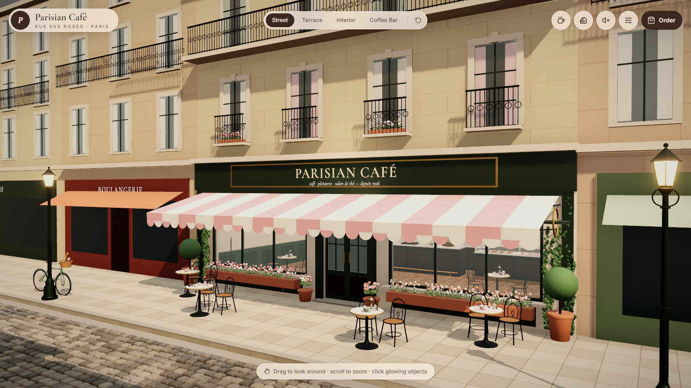
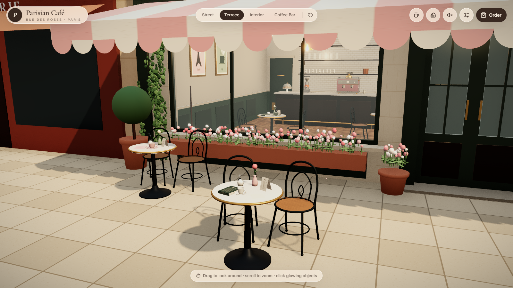
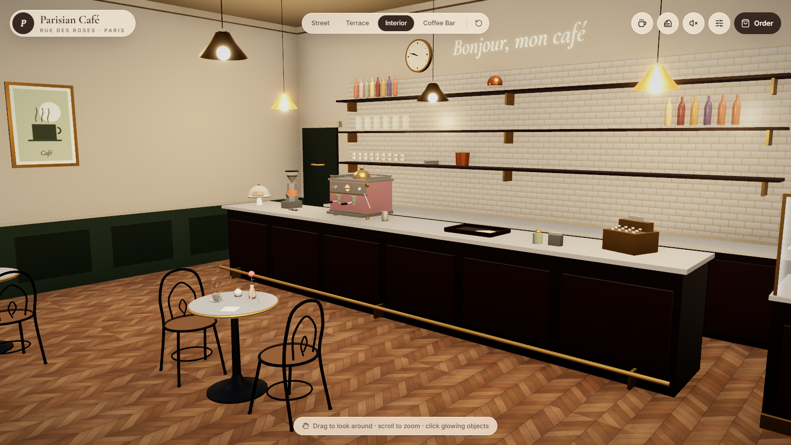
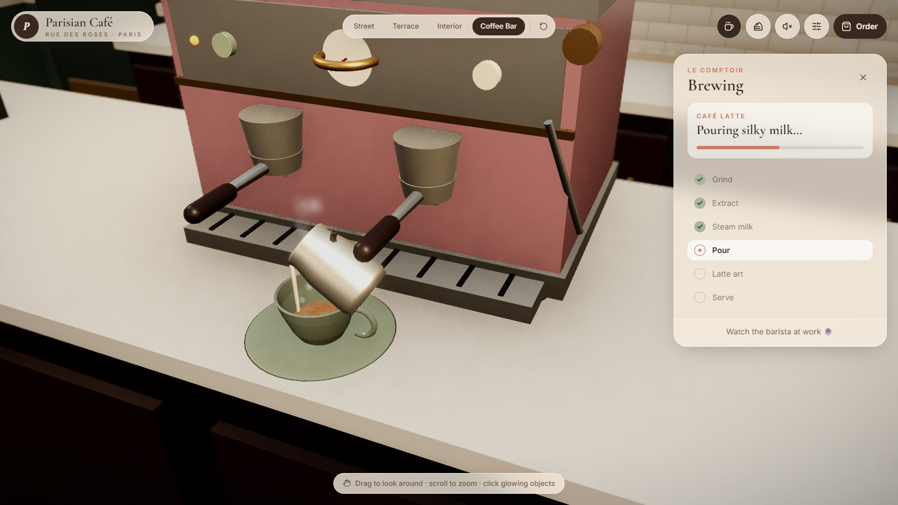
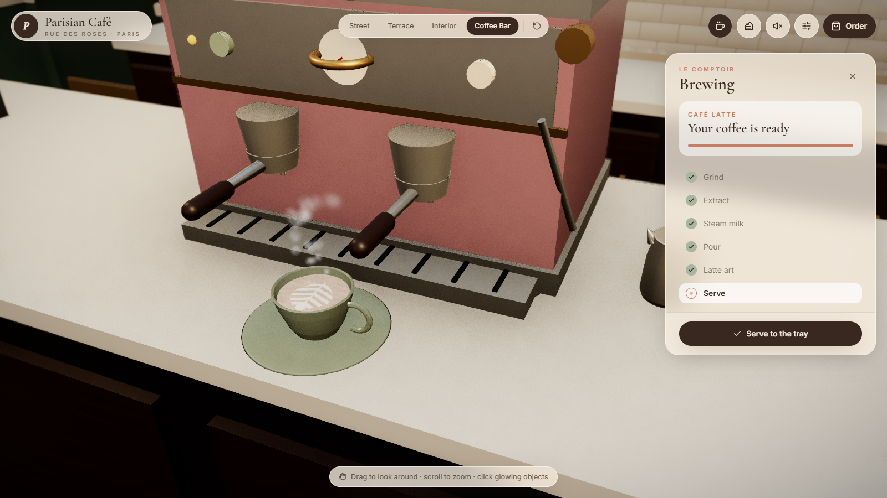
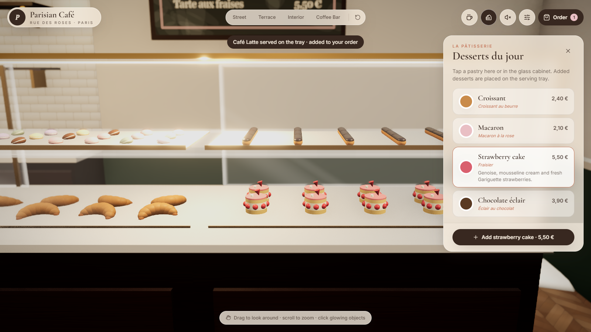
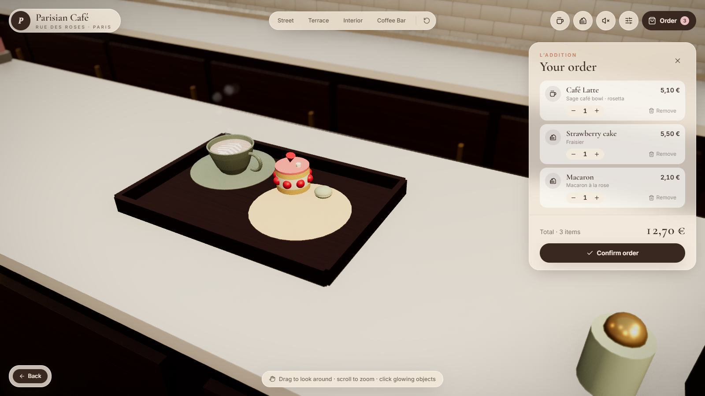

# Parisian Café — a cozy interactive 3D experience

A small French café on a sunny Parisian street, built with **React Three Fiber**. Walk from the cobblestone street onto the terrace and into the café, brew an espresso, cappuccino or latte step by step (with latte art), pick pastries from the glass cabinet, move cups around with real physics and place an order.



| Terrace | Interior |
| --- | --- |
|  |  |
| **Milk pouring** | **Rosetta latte art (custom shader)** |
|  |  |
| **Pâtisserie** | **Order on the physics tray** |
|  |  |

---

## Quick start

Requirements: **Node.js ≥ 22.18** (tested with Node 24) and a WebGL2-capable browser.

```bash
npm install
npm run dev          # http://localhost:5173
```

| Script | What it does |
| --- | --- |
| `npm run dev` | Vite dev server with hot reload |
| `npm run build` | Strict TypeScript check + production build into `dist/` |
| `npm run preview` | Serve the production build locally |
| `npm run typecheck` | TypeScript only |
| `npm run build:models` | Re-generate the GLB models in `public/models/` (see [Assets](#assets--asset-pipeline)) |

The app needs no network access at runtime: fonts, models, textures, the environment map and audio are all local or generated procedurally.

## How to use it

| Action | How |
| --- | --- |
| Look around | Drag (left mouse / one finger), zoom with the wheel / pinch |
| Jump to a viewpoint | **Street · Terrace · Interior · Coffee Bar** in the top bar; ↺ resets the camera |
| Make a coffee | Click the espresso machine or grinder (or the ☕ button) → choose drink + cup → **Start the machine** → choose latte art → **Serve to the tray** |
| Choose desserts | Click a tray in the glass cabinet (or the cake button) → **Add** |
| Move a cup | Press and **drag** any cup; release over a table to set it down. A short click inspects the cup |
| Sit at a table | Click a table → camera moves there → **Drop sugar cubes** |
| Other interactions | Click the **door** to open/close it, click **flowers** to make them bounce and shed petals |
| Order | **Order** button → adjust quantities / remove → **Confirm order** |
| Sound | Speaker button toggles a synthesized café ambience and UI sounds |
| Quality | Sliders button → Low / Medium / High (auto-detected on first load) |
| Close | `Esc` closes a panel, then leaves a close-up |

---

## How each requirement is met

| Requirement | Implementation (main files) |
| --- | --- |
| **Primitive geometries** | Architecture, counter, cabinet, tables, cups (lathe), desserts, railings, cobblestones are built from boxes, cylinders, spheres, lathes, tubes, tori and extrusions. `models/*.tsx`, `models/primitives.tsx` |
| **Complex 3D models** | Bistro chair, Parisian street lamp, animated ceiling fan, croissant and a vintage bicycle are **GLB files** loaded with `useGLTF`. `public/models/*.glb`, `models/ModelSource.tsx` |
| **Custom materials** | A shared PBR material library (incl. `MeshPhysicalMaterial` clearcoat for marble/porcelain) and procedural canvas textures: chevron parquet, métro tiles, dressed stone, sidewalk slabs, awning stripes, posters, chalkboard menu. `materials/` |
| **Lighting** | Hemisphere fill, directional sun, warm pendant point lights, spotlights on the sign and the bar, cabinet light, street-lamp glow, emissive bulbs. `components/three/Lighting.tsx` |
| **Real-time shadows** | `PCFShadowMap` with `shadow.radius` softening, tuned orthographic shadow camera, bias / normal bias, map size by quality preset; tiny props don't cast. |
| **Animations** | Wind-swayed flowers & ivy, falling petals, dust in sunbeams, steam, swinging blade sign, door, cabinet door, live wall clock, GLB fan via **AnimationMixer**, and the whole espresso machine sequence. |
| **Physics** | Rapier rigid bodies for cups, desserts, sugar cubes; fixed colliders; collision groups; table sensors; drag-and-drop. `physics/` |
| **Rendering & post-processing** | ACES filmic tone mapping, sRGB output, local environment map, N8AO ambient occlusion, bloom, depth of field in close-ups, colour grading, vignette, SMAA/MSAA, hover outline. `components/three/effects/PostFX.tsx` |
| **Custom GLSL shaders** | Coffee surface, glass, wet cobblestones, plus sky, foliage, steam and dust shaders. `shaders/` |

---

## Tech stack

React 19 · TypeScript (strict) · Vite 8 · three.js r187 · @react-three/fiber 9 · @react-three/drei 10 · @react-three/rapier 2 · @react-three/postprocessing 3 · Tailwind CSS 4 · Framer Motion · Zustand 5 · Lucide icons · Fontsource (self-hosted Cormorant Garamond & Inter).

## Architecture

```text
src/
├── app/                 App shell, Zustand UI store, dev-only test hooks
├── audio/               Web Audio engine (all sounds synthesized)
├── components/
│   ├── three/           Canvas, scene composition, camera, lighting, environment,
│   │   ├── effects/     post-processing, steam, dust, petals
│   │   └── interactions/ hover/click wrapper (outline + hint + click-vs-drag)
│   └── ui/              Navigation, panels, hints, loading screen, order confirmation
├── constants/           Palette, world layout, quality presets, fonts
├── features/            Business logic, independent from rendering
│   ├── coffee/          drink/cup data, brew state machine, coffee station
│   ├── desserts/        dessert data, selection store, "order dessert" action
│   ├── navigation/      camera viewpoints and limits
│   └── ordering/        order store, pricing
├── materials/           shared PBR materials + procedural canvas textures
├── models/              scene objects (building, interior, furniture, …)
│   └── builders/        procedural GLB sources (also used as a runtime fallback)
├── physics/             Rapier world, colliders, draggable cup, collision groups
├── shaders/             GLSL: coffee, glass, street, foliage, particles, sky, shared noise
└── utils/               math helpers (frame-rate-independent damping, easing)
scripts/build-models.ts  GLB export pipeline
```

Design rules used throughout:

- **Scene composition is separate from object implementation.** `Scene.tsx` only arranges modules.
- **Logic is separate from rendering.** For example, the brewing state machine (`useCoffeeStore`, `coffeeConfig`) knows nothing about meshes; `CoffeeStation` reads it.
- **No React state changes per frame.** Animations read stores through `getState()` inside `useFrame` and mutate refs and uniforms. Progress bars in the UI are motion animations keyed to each phase's start time.
- **Shared resources.** Materials, geometries and textures are created once and reused; components that allocate GPU resources dispose them on unmount.

### The brewing state machine

```
select ─start→ grinding → brewing ─(espresso)→ done ─serve→ serving → select
                             └─(milk drink)→ steaming → pouring-milk → art ─choose→ drawing-art → done
```

Timed phases advance automatically. Each phase drives the 3D animation:
- **Grinding:** the grinder's beans churn.
- **Brewing:** the button presses and the gauge needle rises to 9 bar while twin espresso streams fill the cup and the crema develops in the shader.
- **Steaming:** the wand swings out, the pitcher moves under it and steam plumes.
- **Pouring and art:** the cup slides out onto the counter, then the pitcher tilts and pours, mixing milk into the shader and drawing the art.
- **Serving:** the cup arcs onto the tray and becomes a physics body, and the drink is added to the order.

---

## Custom shaders

| Shader | Type | What it does |
| --- | --- | --- |
| **Coffee surface** `shaders/coffee/coffeeSurface.ts` | `ShaderMaterial` | Domain-warped FBM makes the liquid churn. Crema has "tiger" striping and develops from dark espresso via `uCrema`, with a darker meniscus and a bright rim. Milk spirals in while pouring (`uSwirl`), then settles into micro-foam. Latte art uses an exact heart SDF, a chevron rosetta and a stacked tulip, revealed progressively by `uArtProgress`. Shading comes from a noise-gradient normal plus a glossy highlight. |
| **Glass** `shaders/glass/glassMaterial.ts` | `ShaderMaterial` | Schlick-style fresnel (clear head-on, reflective at grazing angles), with reflections from an analytic sky and the street's facades. Adds edge highlights from UV distance to the pane border, a slow sheen sweep, tint and opacity uniforms. Used for shop windows, doors, upper-floor windows (instanced) and the pastry cabinet. |
| **Wet cobblestones** `shaders/street/wetCobblestone.ts` | `MeshStandardMaterial` + `onBeforeCompile` | Keeps PBR lighting and shadows on ~6,400 instanced stones. Adds procedural grain, FBM puddles, water along both gutters, darkening and near-mirror roughness when wet, animated ripple rings that perturb the normal, and a fresnel sky highlight. |
| Foliage wind `shaders/foliage/windSway.ts` | `onBeforeCompile` | Height-weighted sway for instanced flowers, leaves and ivy, plus a click "pulse" ring that ripples outward. |
| Steam `shaders/particles/steam.ts` | `ShaderMaterial` points | GPU-only looping plume (age = `fract(time·speed + seed)`), so there is no CPU work per particle. |
| Dust motes `components/three/effects/DustMotes.tsx` | `ShaderMaterial` points | Each mote traces a ray toward the sun and only glows if it passes through a shop window, so the visible dust follows the real sunbeams. |
| Sky `shaders/sky/skyDome.ts` | `ShaderMaterial` | Horizon-to-zenith gradient, sun disc and halo, drifting FBM cirrus. |

Shared noise helpers (hash, value noise, FBM) live in `shaders/shared/noise.ts`.

## Physics

- **World:** a single `<Physics>` at 60 Hz with interpolation. Only things that need simulating live in it: cups, desserts and sugar cubes (dynamic), and the surfaces they can touch (fixed).
- **Simplified colliders:** each cup is two cylinders (saucer disc and cup body). Desserts are cuboid, cylinder or capsule. Static slabs are thick (15 cm) and small bodies use CCD, so nothing tunnels through table tops.
- **Collision groups** (`physics/groups.ts`):

  | Group | Collides with |
  | --- | --- |
  | `STATIC` | cups, small items |
  | `CUPS` | everything, including table **sensors** |
  | `SMALL` (desserts, sugar) | static, cups, small |
  | `SENSORS` | cups only |

- **Drag and drop** (`physics/DraggableCup.tsx`): a press freezes the orbit camera. After 6 px of movement the cup switches to a *kinematic* body that follows the pointer on a plane 14 cm above its pick-up height. On release it becomes *dynamic* again, keeps some of the hand's velocity, and settles under gravity. Without that movement, the press counts as a click and inspects the cup instead.
- **Collision detection in use:** each table has a sensor collider. When a cup the user just released enters it, a toast confirms "Cup placed on a terrace table". Impacts above a speed threshold play a synthesized porcelain clink.
- **Physics-based placement:** ordered desserts and served coffees are dropped onto the serving tray (its base and four lips are colliders) and settle there. Sugar cubes rain onto the chosen table.
- A cap of 60 spawned bodies keeps the simulation cheap however long you play.

## Rendering & performance

- **Renderer:** ACES filmic tone mapping (applied once, at the end of the post chain), sRGB output, anisotropic mipmapped textures, PCF soft shadows, PBR materials with a locally baked environment map (`<Environment>` with Lightformers, rendered once).
- **Post-processing:** N8AO, outline (hover), bloom on emissive lamps only (threshold 1.0), depth of field in close-ups (High quality), hue/saturation and contrast grading, ACES, a subtle vignette, and SMAA when MSAA is off.
- **Instancing:**
  - ~6,400 cobblestones, ~830 ivy leaves and all flower stems, leaves and blossoms;
  - ~135 neighbour windows (10 parts each), railing balusters, tree foliage and shelf crockery;
  - chairs and street lamps from GLB, via one `InstancedMesh` per sub-mesh.
- **Static batching:** `components/three/MergeStatic.tsx` bakes all static meshes into one mesh per material and shadow-flag combination after mount. It skips interactive, animated and transparent objects. Measured at about 1,480 → 580 draw calls per frame on the street view, and 880 → 400 inside.
- **GLB optimisation:** merged by material and welded with `mergeVertices`. 30–160 KB each, 400 KB total.
- **Code splitting and lazy loading:** the 3D scene (models, shaders and the ~2 MB Rapier WASM) is a lazy chunk streamed in behind the loading screen. three, R3F, post-processing, physics and React are separate cacheable chunks.
- **Adaptive quality:** Low, Medium and High presets control pixel-ratio range, shadow-map size (1024–4096), AO, bloom, DOF, MSAA and particle counts. Drei's `PerformanceMonitor` lowers DPR when the frame rate drops.
- **Camera:** `CameraControls` with smooth transitions, per-view distance and polar limits, and **collider meshes** so the camera can't pass through walls, floor or facades. Framing adapts to portrait screens and to open side panels via focal offset.
- **Render loop:** continuous animation (steam, foliage, liquid) means rendering stays continuous rather than on-demand, but there are no per-frame React renders anywhere.

## Assets & asset pipeline

All assets are original to this project, so no third-party licenses apply.

- **Complex models (GLB):** `src/models/builders/models.ts` builds them from three.js primitives. `npm run build:models` exports them with `GLTFExporter` to `public/models/*.glb`, including the fan's baked `Spin` animation clip. GLB is Blender-compatible, so an artist can open, refine and re-export any of them without touching code.
- **Fallback:** `ModelSource` wraps every GLB in an error boundary. If a file is missing or corrupt, the identical procedural builder renders instead, so the app never breaks.
- **Textures:** painted on `<canvas>` at startup; there are no image files.
- **Fonts:** self-hosted through `@fontsource`. In-scene signage uses the same WOFF files via troika text.
- **Audio:** synthesized with the Web Audio API.

To swap in higher-fidelity models (e.g. from Poly Haven / Sketchfab — check each license), drop a GLB with the same name into `public/models/` and keep roughly the same scale and origin: metres, Y-up, origin on the floor.

## Browser support & notes

- Verified in Chromium (Microsoft Edge) at desktop (1280–1600 px), tablet (820 × 1180) and phone (390 × 844) sizes. It should run in any WebGL2 browser. Phones get a responsive fallback with a bottom-sheet UI; Low quality is auto-selected on touch devices.
- Two console warnings come from dependencies, not app code: R3F's internal use of the deprecated `THREE.Clock`, and Rapier's WASM init signature.
- N8AO's half-resolution mode is disabled: it uses `WebGLMultipleRenderTargets`, which three r172+ removed. Full-resolution N8AO works normally.
